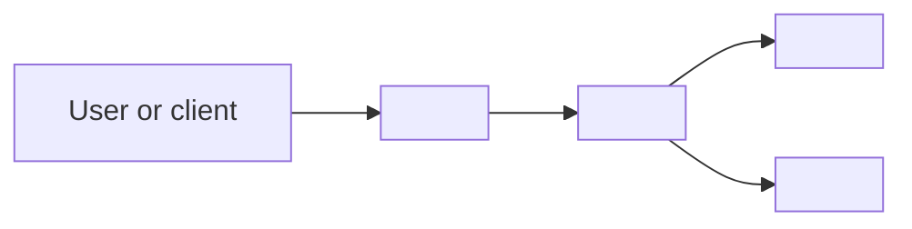

# Architecture

> Fill this in for the repository. It is the map an agent reads before changing
> structure. Keep it current; a stale map is worse than none.

## 1. System shape

TODO: two or three sentences covering what the system does, the main runtime
pieces, and where the boundaries are.

## 2. Context

Replace the nodes and edges with the real system. Keep it to the pieces that
change design decisions.

## 3. Module map

| Path | Responsibility | May depend on | Must not depend on |
|---|---|---|---|
| `<path>` | `<what it owns>` | `<allowed modules>` | `<forbidden modules>` |
| `<path>` | `<what it owns>` | `<allowed modules>` | `<forbidden modules>` |

Rules:

- The map lists ownership, not every file.
- A dependency not in the "may depend on" column needs a decision record: an
  ADR if the repository uses them, otherwise a note in this file.
- Generated and vendored paths are marked read-only.

## 4. Dependency direction

TODO: describe the allowed flow, for example UI -> application -> domain ->
infrastructure. Name the layer that may not import another.

- Cycles are forbidden.
- Cross-layer calls go through the documented interface, not a concrete
  implementation.
- Shared utilities do not import feature modules.

## 5. Data flow

TODO: describe the path of one representative write and one representative
read. Name the validation boundary, the persistence boundary, and the points
where authorization is enforced.

## 6. Invariants

List what must stay true. Each line should be checkable.

- Security: TODO: authorization is enforced server-side at ...
- Data: TODO: migrations are applied forward-only, and each has a tested
  rollback or down path
- Compatibility: TODO: public API changes keep ...
- Performance: TODO: hot path stays under ...
- Privacy: TODO: personal data is never logged, ...

## 7. Additive seams

Prefer these extension points over reshaping working code:

| Need | Seam |
|---|---|
| New table or entity | Migration plus a domain module |
| New screen or route | A new screen module beside the existing ones |
| New service | Router, handler, tests, and a registration entry |
| New integration | Adapter behind the existing interface |
| New platform | Platform module only; no platform branches in shared code |

## 8. External services

| Service | Used for | Failure mode | Fallback |
|---|---|---|---|
| `<service>` | `<purpose>` | `<timeout, outage, rate limit>` | `<degrade, retry, fail closed>` |

Never put credentials in this file. Reference environment variable names only.

## 9. Generated and vendored code

| Path | Source | Regenerate with |
|---|---|---|
| `<path>` | `<generator or vendor>` | `<command>` |

Do not edit these by hand. Change the source and regenerate.

## 10. Decisions

If the repository uses ADRs, an architecture-significant change needs one in the
same pull request. Record the index here (only if used): `docs/adr/README.md`.

If it does not use ADRs, record the decision in this file with the context,
alternatives, and consequences.

## 11. Keeping this current

Update this file when a module boundary, dependency rule, external service, or
invariant changes. If the change is architecture-significant, write the decision
record first (an ADR or a note in this file) and link it here.
